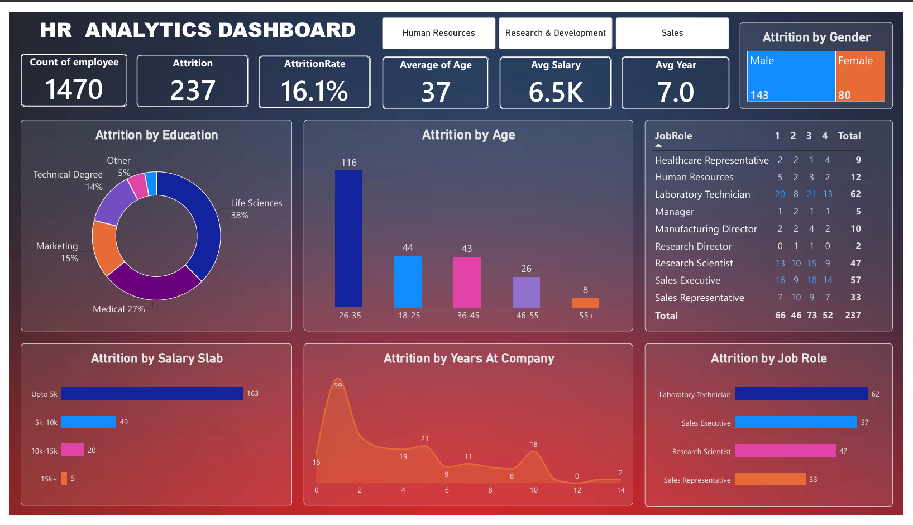

# HR Analytics Dashboard | Power BI

## 📌 Project Overview
A hands-on Power BI practice project analyzing employee attrition and workforce trends to explore key HR metrics and support data-driven decision-making.

## 📊 Dashboard Preview

## 🛠️ Tools & Skills
- **Power BI Desktop** — Dashboard development and visualization
- **Power Query** — Data cleaning and transformation
- **DAX** — Measures and calculations
- **KPI Cards, Charts & Tables** — Data presentation and analysis

## 📈 Key Metrics
- **Total Employees:** 1,470
- **Attrition Cases:** 237
- **Attrition Rate:** 16.1%
- **Average Age:** 37
- **Average Salary:** 6.5K
- **Average Years at Company:** 7

## 🔍 Analysis
- Attrition by age group and gender
- Attrition by education and salary slab
- Attrition by years at company
- Attrition by job role

## 💡 Business Insights
- **Overall Attrition:** 237 employees left, representing an attrition rate of 16.1%.
- **Age Group:** Employees aged 26–35 account for the highest displayed attrition count (116).
- **Salary Slab:** The up-to-5k salary category has the highest displayed attrition count (163).
- **Job Roles:** Laboratory Technicians (62) and Sales Executives (57) have the highest attrition counts among the displayed roles.
- **Gender:** The dashboard shows 143 male and 80 female attrition cases.

These observations identify areas for further investigation. Group-specific attrition rates and additional workforce data would be needed to assess retention risks and understand the factors behind employee turnover.

## 🎯 Learning Outcomes
- Practiced data cleaning and transformation using Power Query.
- Created measures and calculations using DAX.
- Designed KPI cards and data visualizations.
- Built a dashboard to explore HR metrics and workforce trends.
- Practiced translating data into business-oriented observations.

## 🚀 Future Improvements
- Compare attrition rates across job roles and employee groups.
- Investigate factors associated with employee turnover.
- Develop actionable employee retention recommendations.

---

**Project Type:** Power BI Practice Project  
**Domain:** HR Analytics  
**Author:** Nidhi Deval

